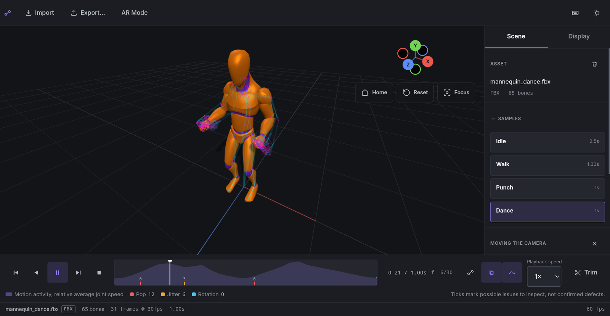

# LAK — Lens on Animation Kinematics

LAK is a web viewer for motion-capture and animation data. Open an FBX or GLB clip in the browser, play it back frame by frame, see how each joint moves, and on a supported Android phone or tablet, place the animated figure on the floor around you in augmented reality.

**Try it:** <https://wisessing.github.io/lak/>



## Features

- **Open your own clips** — FBX or single-file GLB with a skeleton and an animation clip; drop a file on the page or use Import. Four sample clips are built in.
- **Playback** — play forward or backward, step frame by frame, scrub, and change speed.
- **See the motion** — skeleton, ghost poses and motion trails; tap a joint to follow its path.
- **Spot problems** — a motion-activity timeline marks possible pops, jitter and rotation flips to inspect.
- **Edit** — trim and retime a clip. Edits live in the page until you export them.
- **Export** — FBX and GLB with the mesh, skin, skeleton and the current clip (for Blender, Unity or Godot); CSV with joint positions, and optionally rotations, for every frame; JSON with a per-joint speed summary of the clip.
- **AR Mode** — on a supported Android device, place the figure on the floor at life size, half or quarter size, walk around it, and select joints while it plays.
- Works on desktop, tablet and phone screens.

Limits worth knowing: `.gltf` files with separate texture or buffer files are not supported (use a single `.glb`); FBX is assumed to be in centimetres, as most exporters write it; and only the first animation in a file is loaded.

## Requirements

- A current desktop or mobile browser with WebGL 2 for the viewer. LAK is developed and tested in Chrome.
- **AR Mode** needs an Android phone or tablet with Chrome and [Google Play Services for AR](https://play.google.com/store/apps/details?id=com.google.ar.core) (ARCore), held upright. It was tested on a Samsung Galaxy Tab S10 FE and a Galaxy S24 Ultra. iPhone and iPad browsers do not support WebXR AR, so they show the viewer only.
- A textured floor (a rug, carpet or wooden boards) helps AR find the floor; plain glossy tile can take a while.

## Privacy

Files you open are read inside your browser and are never uploaded. LAK itself only loads its own page and its built-in sample clips from the same site, and contains no analytics or tracking. The hosted copy at wisessing.github.io/lak may count page visits through its hosting's cookieless web analytics; that sees which pages load, never your files. (A GLB that refers to textures or buffers at outside web addresses makes the browser fetch them, as any 3D viewer would.) Your choice of dark or studio-grey viewport is the only thing remembered, in the browser's local storage.

## Run it yourself

You need [Node.js](https://nodejs.org/) 20.19 or later (or 22.12 or later).

```sh
npm ci            # install
npm run dev       # development server, usually http://localhost:5173
npm run build     # production build in dist/
npm run preview   # serve the production build
npm run build:check && npm run lint   # type-check, build and lint, as the deploy workflow does
```

The development server listens on your local network as well, so you can open it from a phone on the same Wi-Fi.

AR needs a secure (HTTPS) address. To try AR from your own machine, serve over HTTPS, or connect an Android device by USB and forward the port with `adb reverse tcp:5173 tcp:5173`, then open `http://localhost:5173` on the device.

Pushing to `main` builds the site and publishes it to GitHub Pages (see `.github/workflows/deploy.yml`). In a fork, set **Settings › Pages › Source** to **GitHub Actions** first.

## Sample motions

The mannequin and its four clips (Idle, Walk, Punch, Dance) come from the [Universal Animation Library](https://quaternius.itch.io/universal-animation-library) by [Quaternius](https://quaternius.com), released under CC0 1.0. Each clip is stored as its own FBX file in `public/models`.

## Acknowledgement

LAK was developed at CMKL University with support from the Fundamental Fund (FF68: fiscal year 2568, project 4791326), Thailand Science Research and Innovation (TSRI), under the project "A Prototype System for Motion Data Capture and Mixed Reality Visualization".

## Citing LAK

If you use LAK in your work, please cite it. GitHub's "Cite this repository" button uses [CITATION.cff](CITATION.cff):

> Wisessing, P. (2026). *LAK: Lens on Animation Kinematics* (Version 2.0.0) [Computer software]. CMKL University. https://github.com/wisessing/lak

## License

LAK is released under the [Apache License 2.0](LICENSE). Copyright 2026 CMKL University. See [NOTICE](NOTICE) for attribution, and [THIRD_PARTY_LICENSES.txt](THIRD_PARTY_LICENSES.txt) for the open-source libraries included in the built site.
