# LAK user guide

LAK (Lens on Animation Kinematics) is a web viewer for skeletal motion stored as FBX or GLB files. You open a clip in your browser, play it frame by frame, see how each joint moves, look for possible glitches, trim the clip and export it again. On a supported Android phone or tablet, you can also place the moving figure on the floor around you in augmented reality (AR).

Open LAK here: <https://wisessing.github.io/lak/>

You do not install anything, and your files stay on your device.

## Contents

1. [What you need](#1-what-you-need)
2. [Getting started](#2-getting-started)
3. [The screen at a glance](#3-the-screen-at-a-glance)
4. [Moving the camera](#4-moving-the-camera)
5. [Playing the motion](#5-playing-the-motion)
6. [Seeing the motion](#6-seeing-the-motion)
7. [Finding problems](#7-finding-problems)
8. [Trimming and retiming](#8-trimming-and-retiming)
9. [Exporting](#9-exporting)
10. [AR Mode](#10-ar-mode)
11. [Keyboard shortcuts](#11-keyboard-shortcuts)
12. [Troubleshooting](#12-troubleshooting)
13. [Privacy](#13-privacy)
14. [Credits and licence](#14-credits-and-licence)

## 1. What you need

**For the viewer**

- A current desktop or mobile browser with WebGL 2 (the graphics feature LAK uses to draw in 3D). LAK is developed and tested in Chrome.
- A computer, tablet or phone. The layout changes to fit the screen.

**For AR Mode**

- An Android phone or tablet with Chrome and **Google Play Services for AR** (also called ARCore). The device must be ARCore-certified.
- A secure address (HTTPS). The live site already uses HTTPS.
- Permission for the site to use the camera.
- The device held upright (portrait).
- A floor with some texture, such as a rug, carpet or wooden boards. Plain, shiny tiles can take longer.

iPhone and iPad browsers do not support WebXR AR (the browser feature that AR Mode uses), so they show the viewer only. Meta Quest and other headsets can open the viewer in their browser, but AR Mode does not work there yet.

**Files**

- An FBX file, or a single-file GLB, with a skeleton and at least one animation clip.
- LAK does not need particular bone names. Clips from capture software, Blender, Maya, 3ds Max, game assets or AI motion tools all open the same way. LAK has been tested with humanoid characters; other skeletons should open, but have not been tried.

**Limits**

- `.gltf` files are not accepted, because they need separate texture or buffer files. Export a single `.glb` instead.
- LAK assumes FBX files are in centimetres, as most exporters write them.
- Only the first animation clip in a file is used. Other clips in the same file are ignored.
- LAK has no file-size limit of its own. A very large file may simply take longer to load.

## 2. Getting started

### Open the site

Go to <https://wisessing.github.io/lak/>. With no file open, the viewport shows a card that says **Drop a motion file here**.

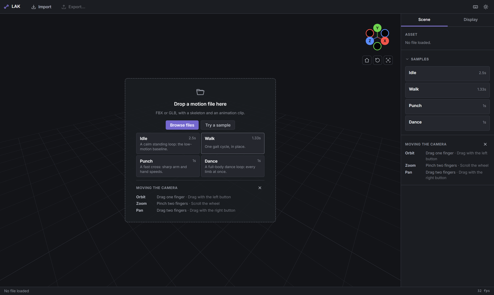

### Try a sample

LAK has four built-in sample clips of a mannequin.

1. Select **Try a sample**. The sample list opens under the button.
2. Select a sample. It loads and starts to play.

| Sample | What it shows | Length |
|---|---|---|
| **Idle** | A calm standing loop: the low-motion baseline. | 2.5 s |
| **Walk** | One gait cycle, in place. | 1.33 s |
| **Punch** | A fast cross: sharp arm and hand speeds. | 1 s |
| **Dance** | A full-body dance loop: every limb at once. | 1 s |

The same samples are also in the **Samples** section of the **Scene** tab, so you can switch between them later.

### Open your own file

Use any of these three ways:

- Select **Browse files** on the empty screen, then pick a file.
- Select **Import** in the top bar, then pick a file. You can do this at any time.
- Drag a file from your computer and drop it on the viewport. While you drag, the viewport shows **Drop to open**. If you drop several files, LAK uses only the first.

While a file loads, you see **Loading motion data** with a progress bar. When it finishes, the camera frames the whole motion and the clip plays. Any joint selection and open trim tool are reset.

### When a file does not open

Messages appear at the top of the screen. They stay until you close them with the **X** (**Dismiss**), a new message replaces them, or (for an error) the next file loads successfully.

| Message | What it means | What to do |
|---|---|---|
| `<file name> is not an FBX or GLB file.` | The file name does not end in `.fbx` or `.glb`. | Export the clip as FBX or single-file GLB. |
| `Failed to load file` | LAK could not read the file. The **Import** button shows this message for any problem, including a wrong file type. | Check that the file is FBX or GLB, has a skeleton and an animation clip, and is not damaged. Try exporting it again from your 3D tool. |
| `Could not load the <name> sample` | A built-in sample did not load, for example because the connection dropped. | Check your internet connection and try again. |

If a file fails to load, the previous clip stays on screen.

If you have applied an edit, LAK asks **Discard the edit?** before it opens another file. See [Edits stay in the page](#edits-stay-in-the-page).

## 3. The screen at a glance

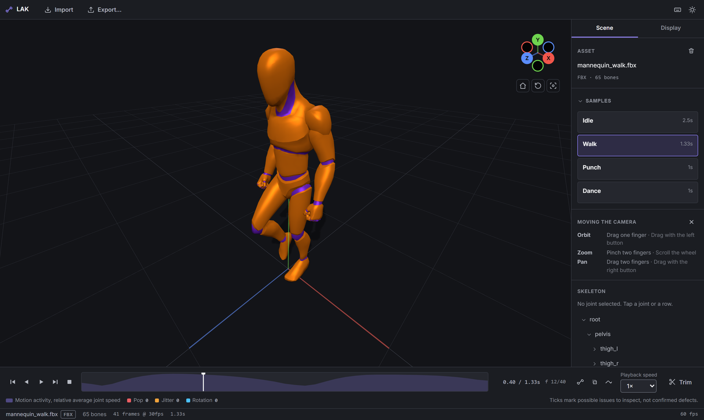

From top to bottom, the screen has these parts:

| Part | What it holds |
|---|---|
| **Top bar** | **Import**, **Export…**, **AR Mode** (only on devices that support it), **edited** (after you apply an edit), the **Keyboard shortcuts** button and the theme button. |
| **Viewport** | The 3D view of the figure. The view gizmo (the coloured axis balls) and the **Home**, **Reset** and **Focus** buttons sit in its corner. |
| **Dock** | A side panel with two tabs, **Scene** and **Display**. |
| **Timeline bar** | Playback buttons, the timeline track, overlay buttons, **Playback speed** and **Trim**. |
| **Status bar** | The file name and format, the number of bones, frames and frame rate, the clip length, **edited** when an edit is applied, and the live drawing rate (for example `60 fps`). |

### The theme button

The theme button at the right of the top bar switches the viewport ground between dark (the default) and studio grey. Studio grey is an 18% reference grey that helps you judge motion. The panels stay dark. LAK remembers your choice in this browser.

### Desktop, tablet and phone layouts

- **Wide screens (more than 900 pixels wide):** the dock is always shown on the right.
- **Narrow screens (900 pixels or less):** the dock becomes a drawer. Open it with the panel button (three lines) in the top bar. Tap outside the drawer to close it. The timeline wraps onto more lines, and the status bar hides the bone count.
- **Phones (560 pixels or less):** the top bar shows **Import**, **Export…** and **AR Mode** as icons only, without words.
- **Touch screens:** buttons are larger, and **Home**, **Reset** and **Focus** show their names under or beside their icons.

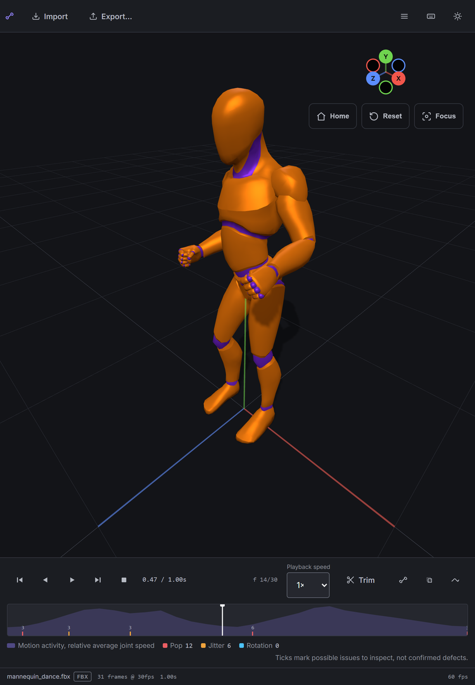

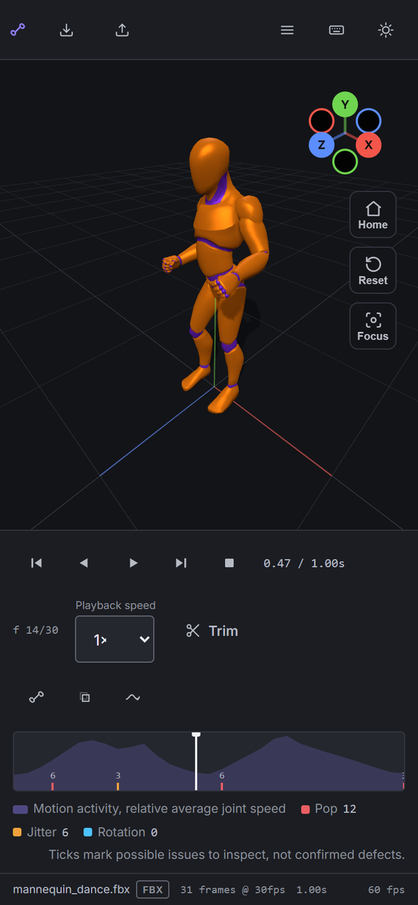

## 4. Moving the camera

The **Moving the camera** panel on the empty screen and in the **Scene** tab lists the gestures. Close it with its **X**; bring it back with **Show camera help** (empty screen) or **Camera help** (**Scene** tab).

| Action | Touch | Mouse |
|---|---|---|
| Orbit (turn around the figure) | Drag one finger | Drag with the left button |
| Zoom | Pinch two fingers | Scroll the wheel |
| Pan (slide the view) | Drag two fingers | Drag with the right button |

### The view gizmo

The gizmo in the corner of the viewport shows the X, Y and Z axes as coloured balls with letters. The balls without letters are the opposite directions.

- Select a ball to look at the figure from that side: **Right view**, **Left view**, **Top view**, **Bottom view**, **Front view** or **Back view**. The zoom and any pan stay the same.
- Drag on the gizmo to orbit, as you would in the viewport.

### Home, Reset and Focus

| Button | Tooltip | What it does |
|---|---|---|
| **Home** | **Home view** | Moves to the default angled view from the front and side. |
| **Reset** | **Reset camera** | Moves to a straight front view. |
| **Focus** | **Focus model** | Frames the figure so the whole motion fits, not only the current pose. LAK does this by itself when a file loads. |

With a mouse, these buttons show icons only; hover over one to see its name.

## 5. Playing the motion

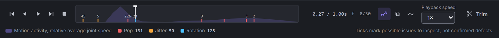

### Playback buttons

From left to right:

| Button | What it does |
|---|---|
| **Previous frame** | Steps back one frame and pauses. |
| **Play backward** | Plays the clip in reverse. Select it again to pause. |
| **Play** | Plays the clip forward. Select it again to pause. |
| **Next frame** | Steps forward one frame and pauses. |
| **Stop** | Pauses and returns to the start (the in point, while the trim tool is open with a changed range). |

The play button for the current direction is lit while it plays. The clip loops. Stepping past the last frame goes to the first, and the other way round. While the trim tool is open with a changed range, looping and stepping stay inside that range.

### Readouts

- The time readout shows the current time and the clip length, for example `0.53 / 1.33s`.
- The frame readout shows the current frame and the last frame, for example `f 16/40`. Frames count from 0. LAK samples motion at 30 frames per second.

### Scrubbing

Press or drag anywhere on the timeline track to move the playhead (the white line). This pauses playback.

### Playback speed

Use **Playback speed** to watch at **0.25×**, **0.5×**, **0.75×**, **1×**, **1.5×** or **2×**. The default is **1×**. This is a viewing setting only. It does not change the clip or any export. To change the clip's own speed, use **Retime clip** in the trim tool.

## 6. Seeing the motion

LAK can draw several layers on top of the figure.

| Layer | What it shows |
|---|---|
| **Skin** | The character's surface (the mesh). |
| **Skeleton** | The bones as lines, with the joints. |
| **Ghost poses** | 5 earlier poses behind the playhead, 5 frames apart. |
| **Motion trails** | The path of each joint over the last 30 frames. |
| **Grid & ground** | The floor grid and ground. |

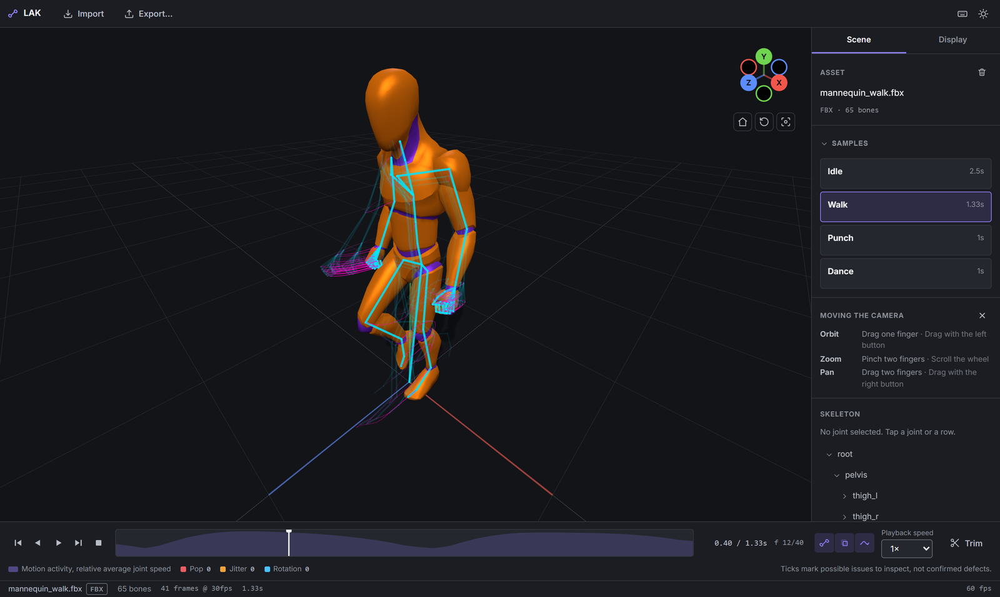

### Turning layers on and off

- **In the timeline bar:** the icon buttons **Skeleton**, **Ghost poses** and **Motion trails**.
- **In the Display tab:** checkboxes for **Skin**, **Skeleton** and **Grid & ground** under **Viewport**, and **Onion skin** and **Motion trails** under **Motion overlays**.

**Onion skin** in the **Display** tab and **Ghost poses** in the timeline are the same setting. Changing one changes the other. Ghost poses and motion trails work with or without the skeleton.

By default, **Skin** and **Grid & ground** are on, and the other layers are off. **Skin** and **Skeleton** cannot both be off: if you turn one off, the other turns on, so the viewport is never empty.

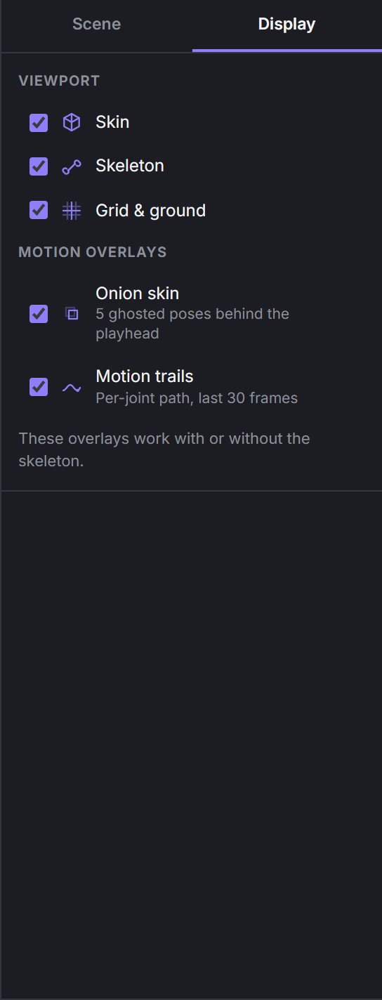

### Selecting a joint

Select a joint to follow one part of the body.

- **In the viewport:** tap or click quickly on or near a joint. A drag, a long press or a two-finger gesture moves the camera instead. You can pick a joint even when the skeleton is hidden.
- **In the skeleton tree:** open the **Scene** tab and select a name under **Skeleton**. Use the small arrows to open and close branches. When you select a joint in the viewport, the tree opens to show it.

When a joint is selected:

- it turns amber, and its name shows under **Skeleton** with an amber dot;
- the skeleton turns on;
- the ghost poses and motion trails show only that joint, with its path as a thicker amber line.

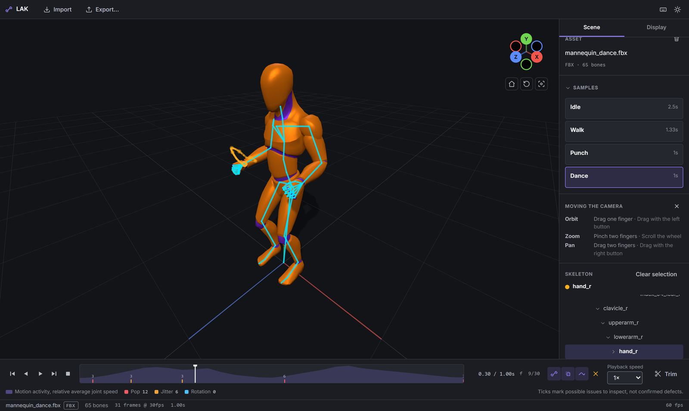

### Clearing the selection

Any of these clears the selection:

- tap or click on empty space in the viewport;
- select **Clear selection** in the **Skeleton** section of the **Scene** tab;
- select the **X** next to the overlay buttons in the timeline;
- select the name of the selected joint again in the tree.

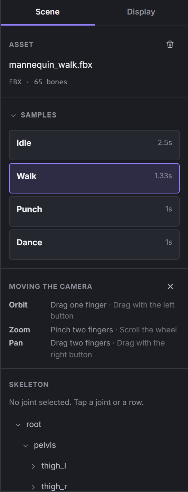

## 7. Finding problems

The timeline helps you find frames that may need a closer look.

### Motion activity

The shaded shape behind the timeline track is the motion activity: the average speed of all joints over time. The highest point of the clip fills the track. Tall areas are fast movement; low areas are calm.

### Issue markers

Coloured ticks on the track mark possible issues. The legend under the track counts each kind:

| Kind | What the app says it means |
|---|---|
| **Pop** | A sudden jump in position between two frames. Possible marker swap or solver slip. |
| **Jitter** | Rapid direction changes over a few frames. Possible tremor or noisy tracking. |
| **Rotation** | An unusually fast turn of the joint. Possible flipped or mis-solved rotation. |

When ticks are close together, LAK joins them into one marker with a number. The marker takes the colour of the most common kind in it.

As the legend says: **Ticks mark possible issues to inspect, not confirmed defects.** A fast, sharp movement can be correct and still get a marker. Always look at the motion yourself before you decide.

### Issue details

1. Select a marker. The playhead does not move. A details panel opens below the timeline.
2. Read each line. It names the kind, the bone, the frame and the time, for example **Jitter** on **neck_01**, frame 1 at 0.03s, followed by the meaning.
3. Select **Go to frame** on a line to pause and jump to that frame.
4. Close the panel with its **X**, or select the marker again.

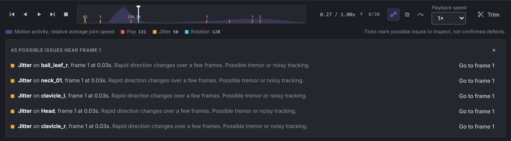

## 8. Trimming and retiming

Trimming keeps only part of the clip. Retiming makes the clip faster or slower.

### Open the trim tool

Select **Trim** in the timeline bar. You can also press **I** or **O**; this opens the tool and sets a mark at the playhead. When the tool opens, the range covers the whole clip.

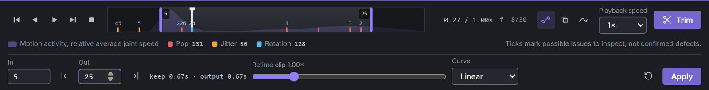

### Set the range

The track shows two handles. The parts outside them are greyed out. Each handle shows its frame number.

- **Drag a handle** on the track.
- **Type a frame number** in the **In** or **Out** field.
- **Set at the playhead:** move the playhead, then select **Set in point at playhead** (or press **I**) or **Set out point at playhead** (or press **O**).
- **Nudge:** press **[** or **]** to move the handle you used last by one frame.

The kept range is always at least 2 frames long. While the tool is open with a change, playback stays inside the range.

The readout next to the fields shows the kept length and the length after retiming, for example `keep 0.67s · output 0.67s`.

### Retime

- **Retime clip** is a slider. Its label shows the new speed, from **4.00×** (four times faster) to **0.25×** (four times slower). Move it right to make the clip longer and slower; move it left to make it shorter and faster.
- **Curve** sets how the speed changes over the clip: **Linear**, **Ease in**, **Ease out** or **Ease in-out**. The ease options keep the total length and only change how the speed is spread over it.

**Retime clip** changes the clip and every export. **Playback speed** does not. They are different settings.

### Apply, undo or leave

- **Apply** replaces the working clip with your edit and closes the trim tool. A message confirms it, and **edited** appears in the top bar and status bar.
- **Reset trim** (the round arrow) returns the range to the whole clip, the speed to 1× and the curve to **Linear**.
- To leave **without** applying, select **Trim** again or press **Esc**. LAK throws away the unapplied change without asking.
- To undo an applied edit, select **Revert to original** in the **Scene** tab. It does not ask for confirmation.

If you apply again, the new edit works on the already edited clip.

### Edits stay in the page

An applied edit exists only in this browser page. Your file on disk does not change. To keep the edit, export it (see [Exporting](#9-exporting)). If you close or reload the page, the edit is lost.

If you open another file, open a sample or clear the model, LAK first asks **Discard the edit?**:

- **Keep editing** closes the dialog and keeps your edit. Esc, the **X** and a click outside the dialog do the same.
- **Discard and continue** throws the edit away and goes on.

## 9. Exporting

Select **Export…** in the top bar. It is available when a file is loaded.

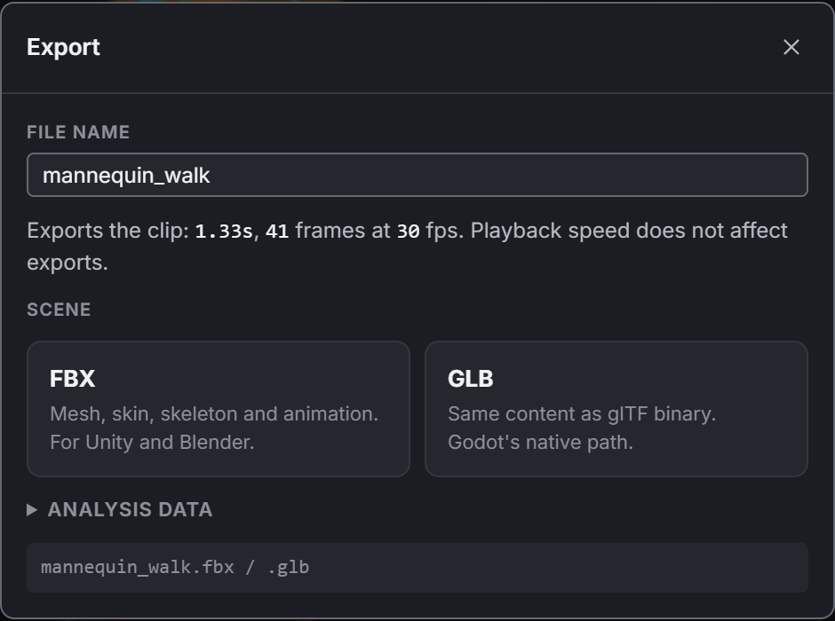

### File name

The **File name** field starts with your source file's name. If you include an unapplied trim, LAK adds a suffix that describes it, for example `mannequin_walk_f5-30_x2_easeIn`. Do not type an extension. LAK removes characters that file names cannot hold. If you change the name, a **reset to** link brings back the suggested name.

The line under the field tells you what you will export: the clip length, the number of frames and the frame rate. **Playback speed does not affect exports.**

### Formats

| Button | File | What it contains | Who it is for |
|---|---|---|---|
| **FBX** | `<name>.fbx` | Mesh, skin, skeleton and animation (binary FBX 7.4). | Blender, Unity |
| **GLB** | `<name>.glb` | The same content as a binary glTF file. | Godot and other glTF tools |
| **CSV** | `<name>_motion.csv` | Joint positions for every frame, with speed and acceleration, and rotations if you choose. | Spreadsheets, Python (pandas), R |
| **JSON** | `<name>_analysis.json` | A summary for each joint: lowest, highest and average speed, and the frame and time of the highest speed, plus details of the clip. | Scripts and reports |

**CSV** and **JSON** are under **Analysis data**. Select it to open the section.

### CSV options

- **CSV layout:**
  - **Long (pandas / R)** (the default): one row per frame per bone. Columns: frame, time, bone, x, y, z, then rotations if included, then speed and acceleration.
  - **Wide (Excel)**: one row per frame, with a group of columns for each bone.
- **Include rotations:** adds each joint's rotation as a quaternion (four numbers: qx, qy, qz, qw). It is off by default.

Positions are world positions in the scene's units, with 6 decimal places.

### Unapplied trims

If the trim tool has a change you have not applied, the dialog shows **Include the unapplied trim**. It is on by default and applies to every format.

### After you export

For FBX and GLB, the card shows **Writing…** while the file is made. When it finishes, the browser saves the file and a message says, for example, `GLB exported`. If something goes wrong, the message says `<format> export failed` with a reason.

## 10. AR Mode

AR Mode places the moving figure on the floor in the room around you, through your device's camera. You can walk around it, change its size and select joints while it plays.

### Before you start

- Use a supported Android device (see [What you need](#1-what-you-need)) and load a clip. The button appears once a clip has loaded on a device that supports AR. If you clear the model, it stays but is greyed out until you load another clip.
- Close the trim tool and any open dialog.
- Hold the device upright.

### Start AR Mode

1. Select **AR Mode** in the top bar. On a phone, it is the headset icon.
2. If the browser asks for camera permission, allow it.
3. The button reads **In AR…** while the session starts, and the camera view opens.

If the device is sideways, AR does not start. You see **Turn the tablet upright to use AR Mode** (the same text appears on phones). Turn the device upright and try again.

LAK tries to keep the screen upright during the session. Some browsers do not allow this.

### Find the floor

At the top of the screen, a coloured dot and a line of text show the status.

| Status text | Dot | What to do |
|---|---|---|
| **Move the tablet to find a flat surface** | Pulsing | Point the camera at the floor and move the device slowly from side to side. |
| **Aim the ring at the floor, then place** | Steady | An amber ring lies on the floor. Aim it where you want the figure. |
| **Placed. Walk around to inspect.** | Steady | The figure is in the room. |
| **Placed. Floor level was unavailable on this device.** | Steady | The figure is placed; its height above the floor may be slightly off. |
| **Paused while the session is hidden** | Grey | A system menu or another screen covers AR. The clip waits and goes on when you return. |

The text says "tablet" on phones too.

Tips for finding the floor:

- Use good light.
- Aim at a floor with texture, such as a rug, carpet or wooden boards. Plain, shiny tiles take longer.
- Keep moving the device slowly. Only flat, level surfaces count; walls and ceilings do not.

While you aim the ring, the status may add **Floor level unavailable on this device**. The device could not measure the floor height exactly. You can still place the figure.

<!-- SCREENSHOT NEEDED: ar-searching.png — reticle (amber ring) on the floor, status line at the top, "Place here" button at the bottom -->

### Place the figure

Select **Place here**, or tap the camera view. The figure stands on the floor at the ring, turned to face you, at life size. **Place here** is greyed out until the ring is on a valid surface.

### The AR control bar

After you place the figure, a control bar appears at the bottom of the screen.

**On phones**, the bar starts small. It holds **Play** (or **Pause**), the timeline and **Show all controls**. The small bar plays forward only.

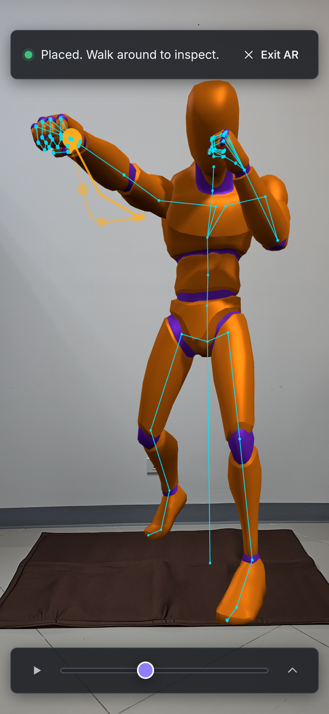

**On tablets**, the bar starts with all controls. On any device, select **Minimize controls** to make it small and **Show all controls** to bring everything back. The full bar has:

- the timeline, which you can drag frame by frame;
- **Previous frame**, **Play backward**, **Play**, **Next frame** and **Stop**;
- the time and frame readout;
- **Skin**, **Skeleton**, **Ghost poses** and **Motion trails**, and **Clear selection** when a joint is selected;
- **Playback speed**;
- **Size**: **Life size**, **½** (half size) or **¼** (quarter size);
- **Reposition**;
- a line that shows which joint is selected.

The layers and **Playback speed** are shared with the normal viewer. Trimming and exporting are not available in AR.

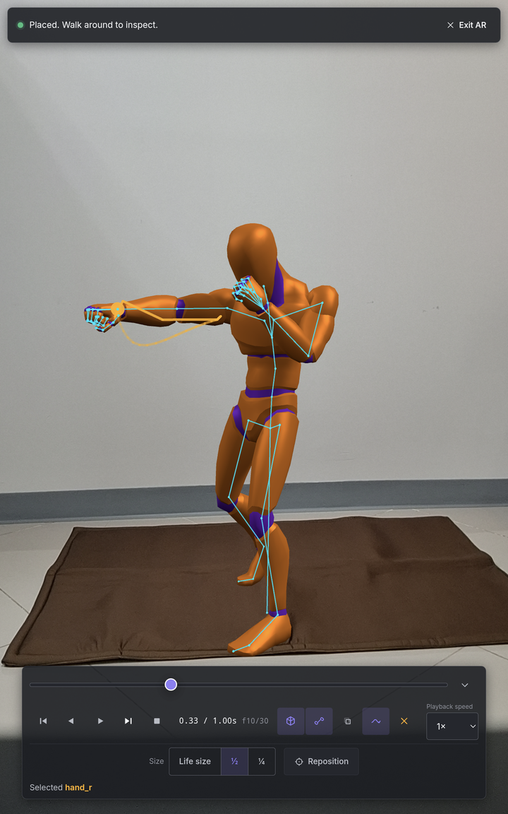

### Size

**Size** changes how big the figure looks in the room. The feet stay on the floor. It is a viewing setting only and does not change the clip or any export. Each new AR session starts at **Life size**.

### Reposition

1. Select **Reposition**. The figure stays where it is, and the ring and **Place here** come back.
2. Aim the ring at the new spot and select **Place here**.
3. To keep the old spot, select **Cancel**.

### Select joints in AR

Tap near a joint on the figure to select it. The full bar shows **Selected** and the joint's name, or **Tap a joint to inspect it** when nothing is selected. If your tap misses, it briefly shows **No joint there. Tap closer to a joint.** and the selection stays.

In AR, the selected joint's trail is drawn thicker so it is easier to see.

### Walk around

Walk around the figure to see it from any side. If the device briefly loses track of the room, the clip pauses. Move slowly and point the camera at the room again. If the figure disappears, tracking was reset: place it again.

### Leave AR Mode

Select **Exit AR** at the top right. LAK returns to the normal viewer with the camera where it was before. Your selected joint, playhead, playback speed and layer settings stay as they were.

On Android, the Back button or Back gesture also ends AR Mode and returns you to the normal viewer in the same way. So does any other way the browser or the system ends the session.

While AR is running, **Import**, **Export…**, **Trim**, the samples and drag-and-drop are turned off.

### When AR does not start

A notice appears at the bottom of the normal viewer. Select **Dismiss** to close it.

| Notice | What it means | What to do |
|---|---|---|
| **AR did not start** | AR or the camera may be blocked for this site, or the device lacks a feature AR needs. | Select the icon beside the address, allow AR and the camera for the site, then try again. |
| **Camera access was not granted** | The site cannot use the camera. | Select the icon beside the address, allow the camera, then try again. |
| **Controls could not be shown over the camera** | The browser started AR but would not show LAK's controls, so LAK ended the session to keep you from being stuck. | Try again. If it happens every time, update Chrome. |
| **The AR session could not start** | Something else went wrong. Normal viewing still works. | Try again. |

Rarely, you may see **This device cannot start an AR session**, **This browser cannot show AR** or **This page is not on a secure origin**. Use Chrome on an ARCore-certified Android device, and open <https://wisessing.github.io/lak/>.

## 11. Keyboard shortcuts

Select the **Keyboard shortcuts** button in the top bar, or press **?**, to see the shortcuts in the app. The last row of the table below, **?**, is not in the app's list.

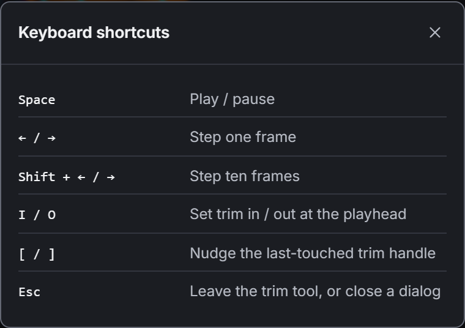

| Key | Action |
|---|---|
| **Space** | Play / pause |
| **← / →** | Step one frame |
| **Shift + ← / →** | Step ten frames |
| **I / O** | Set trim in / out at the playhead |
| **[ / ]** | Nudge the last-touched trim handle |
| **Esc** | Leave the trim tool, or close a dialog |
| **?** | Open the keyboard shortcuts list |

Notes:

- **Space** always plays forward or pauses. It does not resume backward playback.
- While the **Export** or **Discard the edit?** dialog is open, only **Esc** works (it closes the dialog). Shortcuts also do not work while you type in a field or use a drop-down list.
- If a button has keyboard focus, **Space** presses that button instead.
- **I** or **O** opens the trim tool if it is closed. **[** and **]** work only while it is open.
- In AR Mode, **I**, **O**, **[** and **]** do nothing.

## 12. Troubleshooting

**My file does not open.**
See [When a file does not open](#when-a-file-does-not-open). A `.gltf` file needs to be exported again as a single `.glb`.

**The file opens, but there is no timeline.**
The file has no animation clip. Export it again with the animation included.

**The clip I wanted is not the one that plays.**
LAK uses only the first animation in a file. Export the clip you want on its own.

**The figure is tiny or huge.**
Select **Focus** to frame it. If the FBX was not saved in centimetres, its size may look wrong; change the export units in your 3D tool.

**There is no AR Mode button.**
The button appears only after a clip has loaded on a device and browser that support AR (Chrome on an ARCore-certified Android device), on an HTTPS page. iPhone, iPad and desktop browsers do not show it.

**The AR Mode button is greyed out.**
Its tooltip (shown when you point at it with a mouse) gives the reason: **Load a motion file first**, **Wait for the file to finish loading**, **Close the trim tool before entering AR** or **Close the open dialog first**.

**AR did not start, or the camera was not allowed.**
See [When AR does not start](#when-ar-does-not-start).

**The floor is not found.**
See the tips in [Find the floor](#find-the-floor).

**The figure is too big or too small for the room.**
Use **Size** in the AR bar: **Life size**, **½** or **¼**. On a phone, select **Show all controls** first.

**The exported clip is faster or slower than I expected.**
**Retime clip** changes exports; **Playback speed** does not. Check the summary line in the Export dialog.

## 13. Privacy

Files you open are read inside your browser and are never uploaded. LAK itself only loads its own page and its built-in sample clips from the same site, and contains no analytics or tracking. The hosted copy at wisessing.github.io/lak may count page visits through its hosting's cookieless web analytics; that sees which pages load, never your files. (A GLB that refers to textures or buffers at outside web addresses makes the browser fetch them, as any 3D viewer would.) Your choice of dark or studio-grey viewport is the only thing remembered, in the browser's local storage.

## 14. Credits and licence

LAK was developed at CMKL University with support from the Fundamental Fund (FF68), Thailand Science Research and Innovation (TSRI).

The mannequin and its four sample clips come from the Universal Animation Library by Quaternius, released under CC0 1.0.

LAK is released under the Apache License 2.0. See the [README](../README.md) for how to cite LAK, and [NOTICE](../NOTICE) for attributions.
